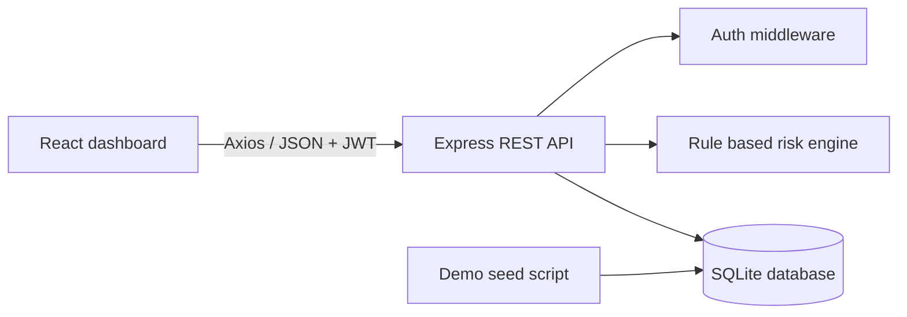

# VoltTrack Lite – Electricity Consumption & Theft Risk Monitoring

A local, demo-ready college major project for manually entered monthly electricity readings. VoltTrack uses clear, configurable rules to flag unusual consumption and prioritize investigation. It does not require smart meters or machine learning.

## Features

- JWT login and registration with ADMIN and USER roles; admin can see all meters, users see their own.
- Meter registry and monthly reading entry, validation, and bulk CSV import with per-row feedback.
- Explainable risk engine, monthly dashboard, risk filters, meter history, and investigation notes.
- Risk report CSV export and downloadable import template.
- SQLite database created automatically on first run; demo seed creates 30 meters and 12 months of sample data.

## Tech stack

React + Vite, React Router, Axios, Recharts, Express, SQLite (`better-sqlite3`), JWT, bcrypt, Multer, csv-parse, Jest.

## Architecture

## Data model

## Run locally

Requires Node.js 18 or newer.

1. Copy `.env.example` to `.env` if you want to customize the port or JWT secret. Defaults work locally.
2. From the repository root, run `npm install`.
3. Run `npm run seed` once to create demo accounts and sample data.
4. Run `npm run dev` and open [http://localhost:5173](http://localhost:5173).
5. Log in as `admin@volttrack.com` / `admin123` (or `demo@volttrack.com` / `demo123`).

SQLite is stored at `server/db/volttrack.sqlite` by default. Set `DB_PATH` to move it. The standalone API defaults to port 3000. The combined `npm run dev` launcher uses port 5000 when available and falls back to 5001 when it is occupied, then connects the Vite client to the selected API port. `npm test` runs the risk engine tests.

## Risk scoring

Each month is compared with the preceding month, the average of up to three earlier readings, same-type meters in that month, and (for commercial and industrial meters) a simple sanctioned-load expectation of `kW × 30 days × 4 hours`. Default triggers are a drop greater than 40%, a rise greater than 60%, zero usage while active, below 10% of expected usage, three consecutive monthly declines, or more than two peer-group standard deviations. Their weights are 30, 10, 25, 15, 10, and 20 points respectively. The sum is capped at 100: 0–30 LOW, 31–60 MEDIUM, 61–100 HIGH. Settings are editable by admins. Every result includes flags and plain-language reasons; this is a screening aid, not a determination of theft.

## API

All endpoints except `/api/health` and `/api/auth/login` and `/api/auth/register` need a bearer JWT.

- Auth: `POST /api/auth/register`, `POST /api/auth/login`, `GET /api/auth/me`
- Meters: `GET/POST /api/meters`, `GET/PUT/DELETE /api/meters/:id`, `PUT /api/meters/:id/investigation`
- Readings: `GET/POST /api/readings`, `PUT/DELETE /api/readings/:id`, `POST /api/readings/upload`
- Analysis and dashboard: `POST /api/analysis/run`, `GET /api/analysis`, `GET /api/dashboard/summary`
- Settings: `GET/PUT /api/settings`
- Reports: `GET /api/reports/export?month=YYYY-MM&format=csv`

## Screenshots

Screenshots can be captured from the running dashboard at `http://localhost:5173`.

## Future scope

PDF reports, stronger account recovery, audit history, utility-scale pagination, and integration with real meter data can be added later.
